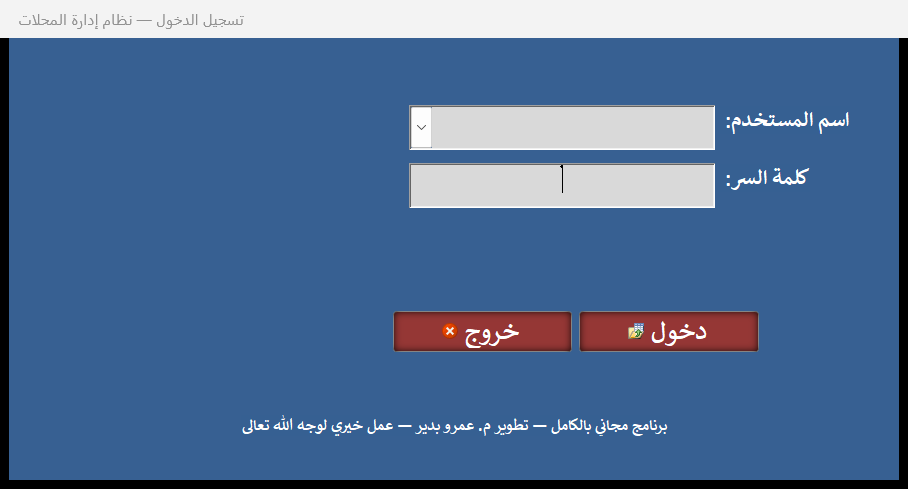
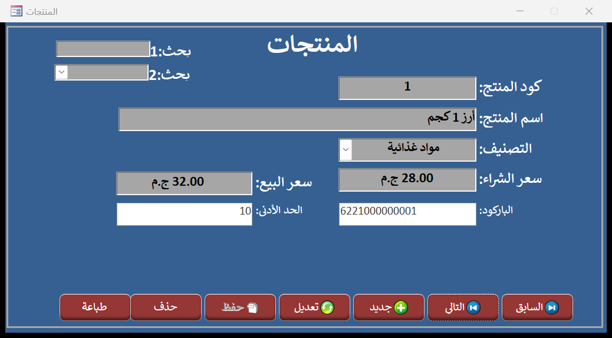
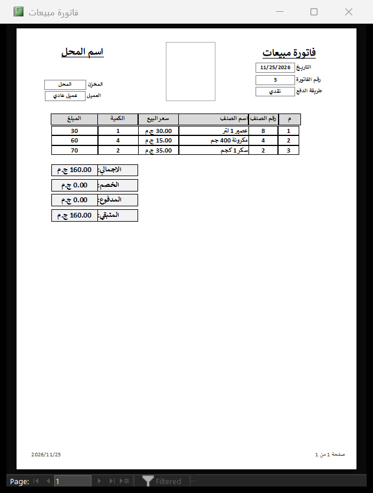
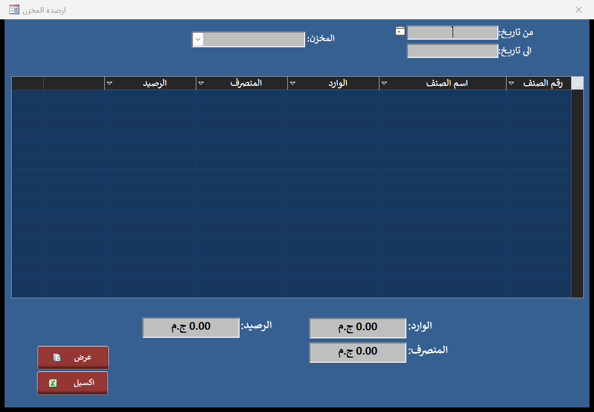
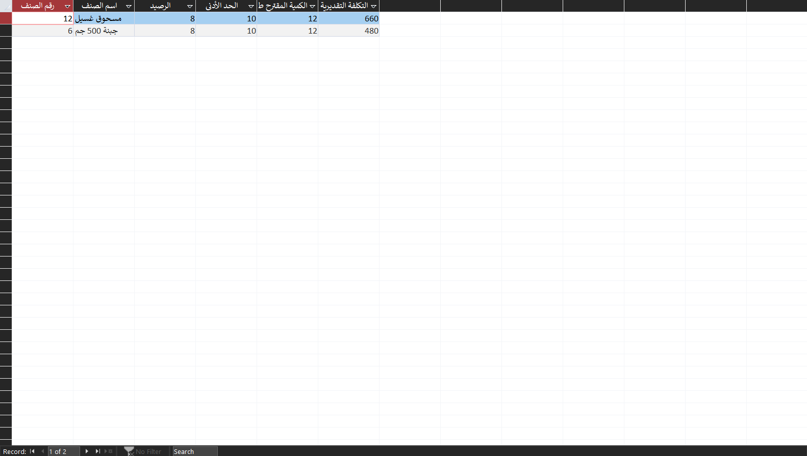
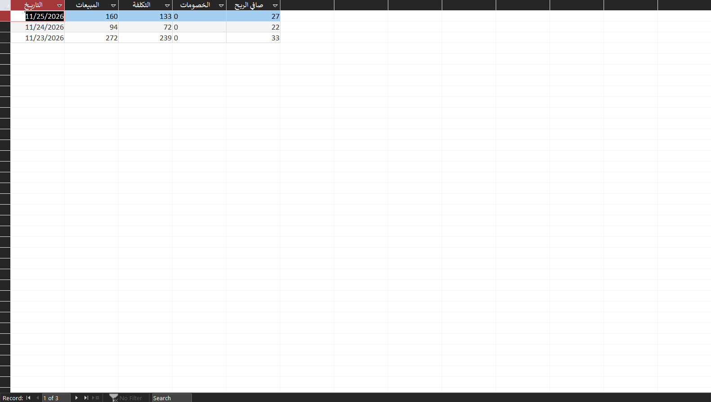
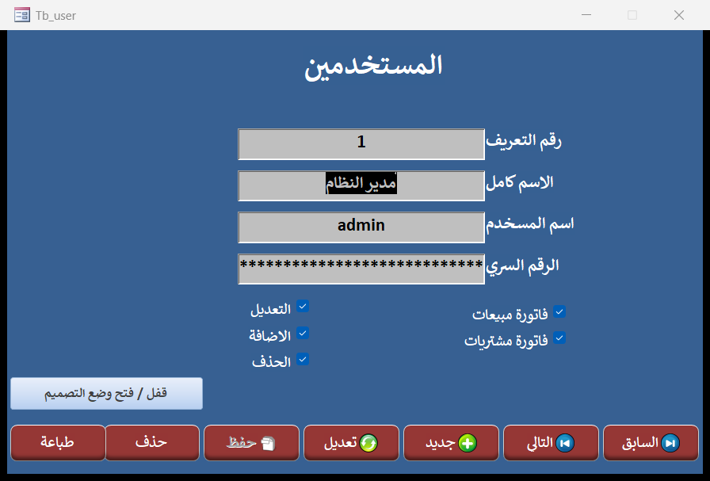

# 🏪 نظام إدارة المحلات — مجاني بالكامل (Microsoft Access)

برنامج عربي متكامل لإدارة **محل أو سوبر ماركت أو أي نشاط تجاري صغير**: الأصناف والمخازن، فواتير البيع والشراء، العملاء والموردين وكشوف حساباتهم، سندات القبض والصرف، أرصدة المخزن، والتقارير، مع مستخدمين وصلاحيات.
شغال على **Microsoft Access** بدون إنترنت، وبياناتك كلها على جهازك.

> **تطوير: م. عمرو بدير** 
> عمل خيري لوجه الله تعالى. البرنامج **مجاني بالكامل ولا يجوز بيعه**. لو استفدت منه، ادعُ لصاحبه ولوالديه بالخير. 🤍

  <a href="https://github.com/AmrBedir/Shop-Management-System-Access/releases/latest/download/Shop-System.accdb"><b>⬇️ تحميل البرنامج</b></a>
  &nbsp;•&nbsp;
  <a href="https://amrbedir.github.io/Shop-Management-System-Access/"><b>🌐 صفحة البرنامج</b></a>
  &nbsp;•&nbsp;
  <a href="https://t.me/Stargito"><b>💬 تواصل على تليجرام</b></a>

---

## 📑 المحتويات

- [المميزات](#-المميزات)
- [المتطلبات](#️-المتطلبات)
- [التحميل والتشغيل](#-التحميل-والتشغيل)
- [شرح البرنامج بالصور](#-شرح-البرنامج-بالصور)
- [ابدأ ببيانات محلك](#-ابدأ-ببيانات-محلك)
- [مشاكل شائعة وحلولها](#️-مشاكل-شائعة-وحلولها)
- [ملاحظات تقنية](#-ملاحظات-تقنية-للمطورين)
- [سجل التحديثات](#-سجل-التحديثات)
- [تواصل معي](#-تواصل-معي)
- [ادعم المشروع](#-ادعم-المشروع)

---

## ✨ المميزات

| | الميزة | التفاصيل |
|---|---|---|
| 📦 | **الأصناف** | اسم الصنف، النوع، سعر الشراء، وسعر البيع |
| 🏬 | **المخازن** | أكتر من مخزن أو فرع، وكل فاتورة مربوطة بمخزن |
| 🧾 | **فواتير المبيعات** | نقدي / فيزا / آجل، مع خصم ومبلغ مدفوع، والسعر بيتكتب لوحده من بيانات الصنف |
| 🚚 | **فواتير المشتريات** | من الموردين، بإجمالي الفاتورة والخصم والمدفوع والمتبقي، مع طباعة ومعاينة |
| 👥 | **العملاء والموردين** | بيانات كاملة ورصيد افتتاحي |
| 💵 | **سندات القبض والصرف** | للعملاء والموردين، نقدًا أو بشيك |
| 📒 | **كشوف الحساب** | كشف حساب عميل أو مورد بين تاريخين، بالرصيد السابق والحالي |
| 📊 | **التقارير** | أرصدة المخزن، حركة الصنف، تقارير فواتير البيع والشراء، والإجماليات |
| 📤 | **تصدير لإكسيل** | أي تقرير بضغطة |
| 📊 | **لوحة تحكم** 🆕 | على الشاشة الرئيسية: مبيعات اليوم، فواتير اليوم، صافي ربح الشهر، الأصناف الناقصة، وأكثر 5 أصناف مبيعاً |
| 📷 | **الباركود** 🆕 | باركود لكل صنف، وامسحه في فاتورة البيع يتضاف لوحده (ومسحة تانية تزود الكمية) |
| 🚫 | **منع البيع بالسالب** 🆕 | مش هيسمحلك تبيع أكتر من الموجود في المخزن (وتقدر تقفلها من الإعدادات) |
| ⚠️ | **النواقص** 🆕 | حد أدنى لكل صنف، وتقرير بالأصناف الناقصة والكمية المقترح طلبها وتكلفتها |
| 💰 | **الأرباح** 🆕 | صافي الربح يومي وشهري (المبيعات − التكلفة − الخصومات) |
| 🖨️ | **طباعة فاتورة البيع** 🆕 | فاتورة جاهزة باسم المحل والخصم والمدفوع والمتبقي |
| 💾 | **نسخة احتياطية** 🆕 | زرار يحفظ نسخة بالتاريخ والوقت، وضغط وإصلاح الملف تلقائي عند الإغلاق |
| 🔐 | **مستخدمين وصلاحيات** | صلاحيات للبيع والشراء والإضافة والتعديل والحذف، و**كلمات السر متشفرة** (SHA-256) 🆕 |
| ⚙️ | **إعدادات المحل** | اسم المحل والتليفون والعنوان والرقم الضريبي واللوجو |
| 🇪🇬 | **الجنيه المصري** 🆕 | كل المبالغ بالجنيه (ج.م) |
| 🆓 | **مجاني 100%** | مفتوح المصدر، استخدمه وانشره |

---

## 🖥️ المتطلبات

- **Windows** 7 أو أحدث.
- **Microsoft Access 2010 أو أحدث** (موجود مع Office Professional و Microsoft 365).
- **معندكش Access؟** نزّل **Microsoft Access Runtime** المجاني من موقع مايكروسوفت، والبرنامج هيشتغل عليه.

---

## 🚀 التحميل والتشغيل

1. نزّل الملف المناسب وحطه في فولدر لوحده (مثلاً `D:\Shop`):

   | الملف | لمين؟ |
   |---|---|
   | [`Shop-System-Empty.accdb`](https://github.com/AmrBedir/Shop-Management-System-Access/releases/latest/download/Shop-System-Empty.accdb) | ✅ **للاستخدام الفعلي**: فاضي، تبدأ فيه بأصنافك على طول |
   | [`Shop-System.accdb`](https://github.com/AmrBedir/Shop-Management-System-Access/releases/latest/download/Shop-System.accdb) | 🔍 **للتجربة**: فيه بيانات تجريبية |

2. **فك الحظر:** كليك يمين على الملف ← **Properties / خصائص** ← علّم على **Unblock / إلغاء الحظر** ← **OK**.
3. افتح الملف، ولو ظهر شريط أصفر اضغط **Enable Content / تمكين المحتوى**.
4. سجّل دخول:
   - **اسم المستخدم:** `admin`
   - **كلمة السر:** `1234`
5. ⚠️ **غيّر كلمة السر فورًا** من: الإعدادات ← تغيير كلمة السر.

> 💡 عشان متضطرش تضغط Enable Content كل مرة: File ← Options ← Trust Center ← Trust Center Settings ← **Trusted Locations** ← ضيف فولدر البرنامج.

---

## 📖 شرح البرنامج بالصور

### 1) تسجيل الدخول
اختار اسم المستخدم واكتب كلمة السر. كل مستخدم بيشوف ويعمل اللي عنده صلاحية ليه بس.

### 2) القائمة الرئيسية ولوحة التحكم
🆕 **لوحة التحكم** بتظهر على طول: مبيعات اليوم (صافي بعد الخصم)، عدد فواتير اليوم، صافي ربح الشهر، عدد الأصناف الناقصة، وأكثر 5 أصناف مبيعاً، مع زراير سريعة لـ **النواقص** و**أرصدة الأصناف** و**الأرباح اليومية والشهرية** و**النسخة الاحتياطية**.

والقائمة فيها 4 أقسام:
- **الأساسي:** العملاء، الموردين، المخازن، الأصناف، أنواع الأصناف.
- **الإدخالات:** فاتورة شراء، فاتورة بيع، سند قبض، سند صرف.
- **التقارير:** تقارير المشتريات والمبيعات، حركة الصنف، أرصدة المخزن، كشف حساب عميل ومورد، الإجماليات.
- **الإعدادات:** بيانات المحل، المستخدمين، تغيير كلمة السر.

### 3) الأصناف
سجّل كل صنف بنوعه وسعر الشراء وسعر البيع، و🆕 **الباركود** (امسحه بالقارئ في الخانة) و🆕 **الحد الأدنى** (لو الرصيد وصل له، الصنف يظهر في النواقص). استخدم **جديد** ثم **حفظ**، و**تعديل** لتغيير صنف موجود.

### 4) فاتورة المبيعات
1. **جديد** ← اختار **نوع الفاتورة** (نقدي / فيزا / آجل) و**المخزن** و**العميل**.
2. في الجدول اختار **الصنف**، وسعر البيع بيتكتب لوحده، واكتب **الكمية**.
3. البرنامج بيرفض تكرار نفس الصنف في نفس الفاتورة، و🆕 **بيرفض البيع بأكتر من الموجود في المخزن** ويقولك المتاح كام.
4. اكتب **الخصم** و**المبلغ المدفوع** ← **حفظ**.
5. 🆕 **طباعة**: بتطلع فاتورة جاهزة باسم المحل فيها الإجمالي والخصم والمدفوع والمتبقي.

🆕 **بالباركود:** دوس في خانة **باركود** فوق وامسح العلبة. الصنف بيتضاف للفاتورة بسعره، ولو مسحته تاني الكمية بتزيد 1. (لو مفيش قارئ، اكتب الباركود أو رقم الصنف واضغط Enter.)

### 5) فاتورة المشتريات
نفس الفكرة مع **المورد** وسعر الشراء. بتظهر **إجمالي الفاتورة** و**المتبقي** لوحدهم، ومنها **طباعة** و**معاينة** الفاتورة. وزرار **إضافة مخزن** لو محتاج مخزن جديد.

### 6) العملاء والموردين
الاسم والتليفون والعنوان والرصيد الافتتاحي. ودبل كليك على العميل من القوائم بيفتح بياناته.

### 7) سندات القبض والصرف
سجّل أي فلوس دخلت من عميل (قبض) أو خرجت لمورد (صرف)، نقدًا أو بشيك (برقم الشيك والبنك). السندات بتدخل في كشوف الحساب تلقائي.

### 8) التقارير
اختار **من تاريخ** و**إلى تاريخ** (والمخزن أو العميل لو التقرير بيطلب) ← **عرض**. وزرار **إكسيل** بيصدّر التقرير.

**أرصدة المخزن** (الوارد والمنصرف والرصيد لكل صنف):

**تقرير فواتير المبيعات** (بالعميل وطريقة الدفع والإجمالي):

**🆕 النواقص** (من لوحة التحكم): الأصناف اللي رصيدها وصل للحد الأدنى، بالكمية المقترح طلبها (ضعف الحد الأدنى ناقص الرصيد) والتكلفة التقديرية:

**🆕 الأرباح اليومية والشهرية**: المبيعات، التكلفة (بسعر الشراء)، الخصومات، وصافي الربح:

### 9) إعدادات المحل
اسم المحل والتليفون والعنوان والرقم الضريبي واللوجو، وبيظهروا في المطبوعات. و🆕 خانة **منع البيع بأكثر من الكمية الموجودة في المخزن** (شيل العلامة لو عاوز تسمح بالبيع بالسالب).

### 10) المستخدمين والأمان 🆕
- كلمات السر **متشفرة** (SHA-256)، فمحدش يقدر يقراها حتى لو فتح الجداول.
- زرار **قفل / فتح وضع التصميم**: بيقفل زرار Shift عشان محدش يفتح جداول البرنامج، وبيطلب كلمة سر المستخدم الحالي.

### 11) النسخة الاحتياطية 🆕
زرار **نسخة احتياطية** في لوحة التحكم بيحفظ نسخة كاملة في فولدر `Backups` جنب البرنامج، باسم فيه التاريخ والوقت. والبرنامج كمان **بيضغط ويصلح الملف لوحده** كل ما تقفله، عشان يفضل صغير وسليم.

---

## 🏁 ابدأ ببيانات محلك

**الأسهل:** نزّل [`Shop-System-Empty.accdb`](https://github.com/AmrBedir/Shop-Management-System-Access/releases/latest/download/Shop-System-Empty.accdb) (فاضي)، وبعدين:

1. **الإعدادات ← بيانات المحل:** اكتب اسم محلك وبياناته.
2. **الإعدادات ← المستخدمين:** ضيف المستخدمين وصلاحياتهم، و**غيّر كلمة سر admin**.
3. سجّل أصنافك (بالباركود والحد الأدنى).
4. سجّل **فاتورة شراء** بالكميات اللي عندك (رصيد أول المدة)، لأن البرنامج **مش هيبيع صنف ملوش رصيد**.
5. ابدأ البيع. 🎉

> 💾 خد نسخة من ملف البرنامج كل يوم أو كل أسبوع على فلاشة أو Google Drive.

---

## 🛠️ مشاكل شائعة وحلولها

| المشكلة | الحل |
|---|---|
| الزراير مش بتعمل حاجة | اعمل **Unblock** للملف، وبعدين **Enable Content**، أو حطه في **Trusted Location** |
| "Microsoft Access can't find the database" أو مشكلة في الفتح | اتأكد إن عندك Access 2010+ أو Access Runtime، وإن الملف مش مفتوح من جوه ملف ZIP |
| نسيت كلمة السر | افتح الملف وأنت ضاغط **Shift**، وفي جدول `Tb_user` اكتب كلمة سر جديدة عادي في خانة `password` (البرنامج بيقبلها)، وادخل بيها وبعدين احفظ المستخدم من شاشة المستخدمين عشان تتشفر. لو Shift مقفول، افتحه الأول من زرار «قفل / فتح وضع التصميم» |
| «الكمية المطلوبة أكبر من المتاح» | سجّل فاتورة شراء للصنف، أو شيل علامة «منع البيع بأكثر من الكمية» من الإعدادات |
| «الباركود غير مسجل لأي صنف» | اكتب الباركود في بيانات الصنف من شاشة الأصناف |
| "الصنف مكرر!" | الصنف موجود بالفعل في نفس الفاتورة، عدّل الكمية بدل ما تضيفه تاني |
| "ليس لديك صلاحية!" | المستخدم مالوش صلاحية للعملية دي، عدّلها من شاشة المستخدمين |

---

## 👨‍💻 ملاحظات تقنية (للمطورين)

- كل النصوص العربية في الكود مكتوبة بأكواد Unicode عن طريق الدالة `AR()` في موديول `modArabic`، عشان البرنامج يشتغل على أي ويندوز، حتى لو خيار **Beta: Use Unicode UTF-8** مفعل.
- **الجداول:** `Tb_product`، `Tb_stock`، `Tb_type`، `Tb_customers`، `Tb_vendors`، `Tb_sales1/2` (رأس وتفاصيل البيع)، `Tb_purchse1/2` (الشراء)، `Tb_payment1/2` (سندات العملاء والموردين)، `Tb_user`، `Tb_setting`.
- كشوف الحساب مبنية على استعلامات `UNION` بين الفواتير والسندات (`Q_customer_account*` و `Q_vendor_account*`).
- موديول `modShop`: تشفير كلمات السر (SHA-256 مكتوب بـ VBA بدون أي مكتبات)، حساب الرصيد (`StockOf`)، منع البيع (`CanSell`)، لوحة التحكم، والنسخ الاحتياطي.
- استعلامات جديدة: `Q_stock_balance`، `Q_shortages`، `Q_profit_daily`، `Q_profit_monthly`، `Q_top5`، `Q_sales_lines`.
- حقول جديدة: `Tb_product.barcode` و `Tb_product.min_qty`، و `Tb_setting.block_oversell`.

---

## 📝 سجل التحديثات

### v2.0 — نوفمبر 2026
- 🆕 لوحة تحكم على الشاشة الرئيسية، وتقارير النواقص والأرباح اليومية والشهرية وأرصدة الأصناف.
- 🆕 باركود للأصناف وإضافة الأصناف للفاتورة بالقارئ.
- 🆕 منع البيع بأكتر من المخزون (قابل للإيقاف من الإعدادات)، وحد أدنى لكل صنف.
- 🆕 طباعة فاتورة المبيعات.
- 🆕 تشفير كلمات السر، وشاشة قفل وضع التصميم بقت بكلمة سر المستخدم من شاشة المستخدمين (بدل الأكواد الثابتة).
- 🆕 زرار نسخة احتياطية، وضغط وإصلاح تلقائي عند الإغلاق، وكل المبالغ بالجنيه المصري.
- 🆕 نسخة فاضية للاستخدام الفعلي (`Shop-System-Empty.accdb`).
- إصلاح: فاتورة المشتريات المطبوعة كانت بتظهر #Name? في الخصم والمدفوع والمتبقي.

### v1.0 — نوفمبر 2026 (أول إصدار عام)
- إصلاح الرسائل العربية اللي كانت بتظهر حروف غريبة على ويندوز الحديث.
- إصلاح خطأ في الكود كان بيمنع تجميعه (Compile)، وتنظيف أوامر ناقصة.
- إصلاح: تحذيرات Access كانت بتتقفل ومبتشتغلش تاني بعد أي حذف.
- إصلاح: زرار الحذف في شاشة المستخدمين كان بيقف بعد الحفظ.
- إصلاح: تصدير كشف حساب العميل لإكسيل.
- إضافة: التحقق من صلاحية الشراء قبل فتح فاتورة الشراء (زي البيع).
- تصحيح إملائي للرسائل، وعناوين عربية للشاشات، وبيانات تجريبية عامة.

---

## 📬 تواصل معي

- 💬 **تليجرام:** [@Stargito](https://t.me/Stargito)
- 🌐 **موقعي:** [amrbedir.me](https://amrbedir.me)
- 🐞 **مشكلة أو اقتراح؟** افتح [Issue](https://github.com/AmrBedir/Shop-Management-System-Access/issues)
- 💊 **شوف كمان:** [نظام إدارة الصيدليات المجاني (Excel)](https://amrbedir.github.io/Pharmacy-System-Excel/)

---

## 💚 ادعم المشروع

البرنامج مجاني وهيفضل مجاني. لو حابب تساعد:
- ⭐ اعمل **Star** للمشروع.
- 📤 ابعته لأي صاحب محل محتاجه.
- 💖 ولو حابب تدعم تطوير برامج خيرية تانية: [**GitHub Sponsors**](https://github.com/sponsors/AmrBedir).

---

## 📄 الترخيص

مجاني للاستخدام والتعديل والنشر لأي غرض خيري أو شخصي. **ممنوع بيعه.**
لو نشرته أو طورت عليه، يا ريت تحافظ على ذكر المطور الأصلي.

  <b>تطوير م. عمرو بدير</b> 
  عمل خيري لوجه الله تعالى 🤍

