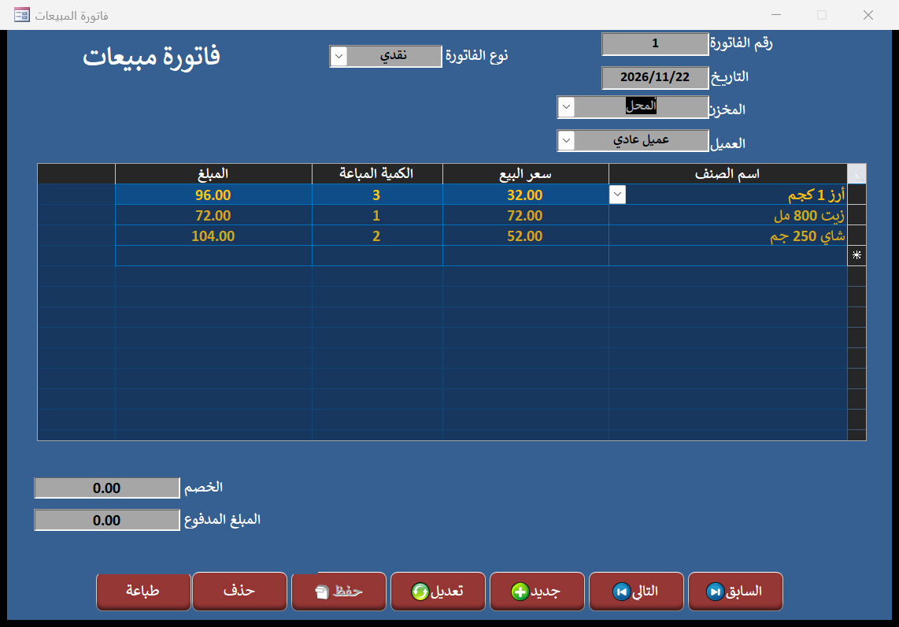
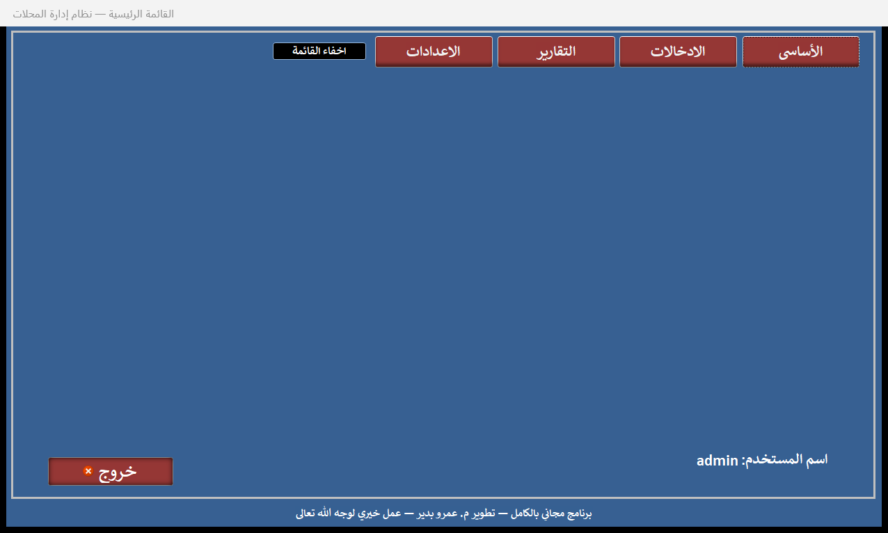
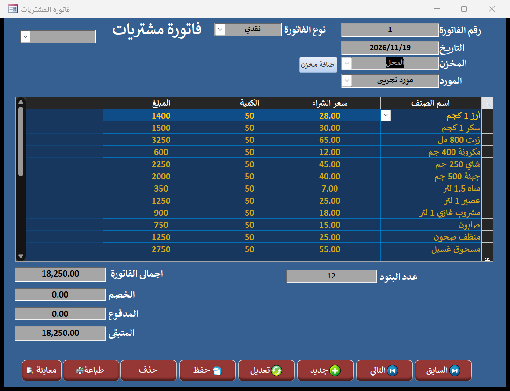
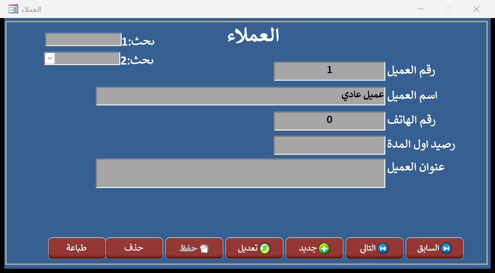
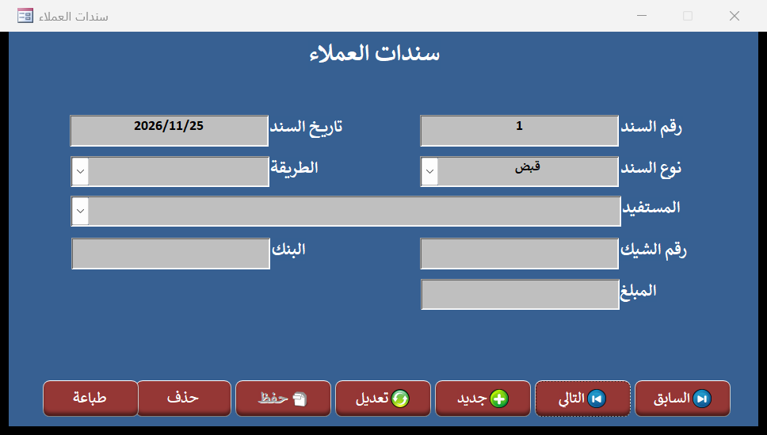
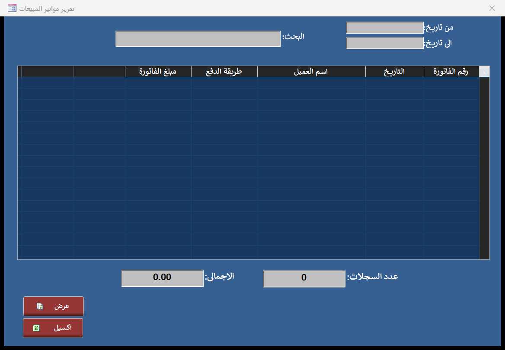
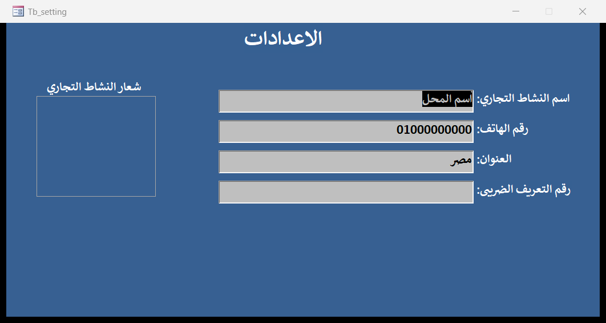

# 🏪 نظام إدارة المحلات — مجاني بالكامل (Microsoft Access)

برنامج عربي متكامل لإدارة **محل أو سوبر ماركت أو أي نشاط تجاري صغير**: الأصناف والمخازن، فواتير البيع والشراء، العملاء والموردين وكشوف حساباتهم، سندات القبض والصرف، أرصدة المخزن، والتقارير، مع مستخدمين وصلاحيات.
شغال على **Microsoft Access** بدون إنترنت، وبياناتك كلها على جهازك.

> **تطوير: م. عمرو بدير** 
> عمل خيري لوجه الله تعالى. البرنامج **مجاني بالكامل ولا يجوز بيعه**. لو استفدت منه، ادعُ لصاحبه ولوالديه بالخير. 🤍

  <a href="https://github.com/AmrBedir/Shop-Management-System-Access/releases/latest/download/Shop-System.accdb"><b>⬇️ تحميل البرنامج</b></a>
  &nbsp;•&nbsp;
  <a href="https://amrbedir.github.io/Shop-Management-System-Access/"><b>🌐 صفحة البرنامج</b></a>
  &nbsp;•&nbsp;
  <a href="https://t.me/Stargito"><b>💬 تواصل على تليجرام</b></a>

---

## 📑 المحتويات

- [المميزات](#-المميزات)
- [المتطلبات](#️-المتطلبات)
- [التحميل والتشغيل](#-التحميل-والتشغيل)
- [شرح البرنامج بالصور](#-شرح-البرنامج-بالصور)
- [ابدأ ببيانات محلك](#-ابدأ-ببيانات-محلك)
- [مشاكل شائعة وحلولها](#️-مشاكل-شائعة-وحلولها)
- [ملاحظات تقنية](#-ملاحظات-تقنية-للمطورين)
- [سجل التحديثات](#-سجل-التحديثات)
- [تواصل معي](#-تواصل-معي)
- [ادعم المشروع](#-ادعم-المشروع)

---

## ✨ المميزات

| | الميزة | التفاصيل |
|---|---|---|
| 📦 | **الأصناف** | اسم الصنف، النوع، سعر الشراء، وسعر البيع |
| 🏬 | **المخازن** | أكتر من مخزن أو فرع، وكل فاتورة مربوطة بمخزن |
| 🧾 | **فواتير المبيعات** | نقدي / فيزا / آجل، مع خصم ومبلغ مدفوع، والسعر بيتكتب لوحده من بيانات الصنف |
| 🚚 | **فواتير المشتريات** | من الموردين، بإجمالي الفاتورة والخصم والمدفوع والمتبقي، مع طباعة ومعاينة |
| 👥 | **العملاء والموردين** | بيانات كاملة ورصيد افتتاحي |
| 💵 | **سندات القبض والصرف** | للعملاء والموردين، نقدًا أو بشيك |
| 📒 | **كشوف الحساب** | كشف حساب عميل أو مورد بين تاريخين، بالرصيد السابق والحالي |
| 📊 | **التقارير** | أرصدة المخزن، حركة الصنف، تقارير فواتير البيع والشراء، والإجماليات |
| 📤 | **تصدير لإكسيل** | أي تقرير بضغطة |
| 🔐 | **مستخدمين وصلاحيات** | صلاحيات للبيع والشراء والإضافة والتعديل والحذف، وتغيير كلمة السر |
| ⚙️ | **إعدادات المحل** | اسم المحل والتليفون والعنوان والرقم الضريبي واللوجو |
| 🆓 | **مجاني 100%** | مفتوح المصدر، استخدمه وانشره |

---

## 🖥️ المتطلبات

- **Windows** 7 أو أحدث.
- **Microsoft Access 2010 أو أحدث** (موجود مع Office Professional و Microsoft 365).
- **معندكش Access؟** نزّل **Microsoft Access Runtime** المجاني من موقع مايكروسوفت، والبرنامج هيشتغل عليه.

---

## 🚀 التحميل والتشغيل

1. نزّل [`Shop-System.accdb`](https://github.com/AmrBedir/Shop-Management-System-Access/releases/latest/download/Shop-System.accdb) وحطه في فولدر لوحده (مثلاً `D:\Shop`).
2. **فك الحظر:** كليك يمين على الملف ← **Properties / خصائص** ← علّم على **Unblock / إلغاء الحظر** ← **OK**.
3. افتح الملف، ولو ظهر شريط أصفر اضغط **Enable Content / تمكين المحتوى**.
4. سجّل دخول:
   - **اسم المستخدم:** `admin`
   - **كلمة السر:** `1234`
5. ⚠️ **غيّر كلمة السر فورًا** من: الإعدادات ← تغيير كلمة السر.

> 💡 عشان متضطرش تضغط Enable Content كل مرة: File ← Options ← Trust Center ← Trust Center Settings ← **Trusted Locations** ← ضيف فولدر البرنامج.

---

## 📖 شرح البرنامج بالصور

### 1) تسجيل الدخول
اختار اسم المستخدم واكتب كلمة السر. كل مستخدم بيشوف ويعمل اللي عنده صلاحية ليه بس.

### 2) القائمة الرئيسية
4 أقسام:
- **الأساسي:** العملاء، الموردين، المخازن، الأصناف، أنواع الأصناف.
- **الإدخالات:** فاتورة شراء، فاتورة بيع، سند قبض، سند صرف.
- **التقارير:** تقارير المشتريات والمبيعات، حركة الصنف، أرصدة المخزن، كشف حساب عميل ومورد، الإجماليات.
- **الإعدادات:** بيانات المحل، المستخدمين، تغيير كلمة السر.

### 3) الأصناف
سجّل كل صنف بنوعه وسعر الشراء وسعر البيع. استخدم **جديد** ثم **حفظ**، و**تعديل** لتغيير صنف موجود، و**السابق / التالي** للتنقل.

### 4) فاتورة المبيعات
1. **جديد** ← اختار **نوع الفاتورة** (نقدي / فيزا / آجل) و**المخزن** و**العميل**.
2. في الجدول اختار **الصنف**، وسعر البيع بيتكتب لوحده، واكتب **الكمية**.
3. البرنامج بيرفض تكرار نفس الصنف في نفس الفاتورة.
4. اكتب **الخصم** و**المبلغ المدفوع** ← **حفظ**.

### 5) فاتورة المشتريات
نفس الفكرة مع **المورد** وسعر الشراء. بتظهر **إجمالي الفاتورة** و**المتبقي** لوحدهم، ومنها **طباعة** و**معاينة** الفاتورة. وزرار **إضافة مخزن** لو محتاج مخزن جديد.

### 6) العملاء والموردين
الاسم والتليفون والعنوان والرصيد الافتتاحي. ودبل كليك على العميل من القوائم بيفتح بياناته.

### 7) سندات القبض والصرف
سجّل أي فلوس دخلت من عميل (قبض) أو خرجت لمورد (صرف)، نقدًا أو بشيك (برقم الشيك والبنك). السندات بتدخل في كشوف الحساب تلقائي.

### 8) التقارير
اختار **من تاريخ** و**إلى تاريخ** (والمخزن أو العميل لو التقرير بيطلب) ← **عرض**. وزرار **إكسيل** بيصدّر التقرير.

**أرصدة المخزن** (الوارد والمنصرف والرصيد لكل صنف):

**تقرير فواتير المبيعات** (بالعميل وطريقة الدفع والإجمالي):

### 9) إعدادات المحل
اسم المحل والتليفون والعنوان والرقم الضريبي واللوجو، وبيظهروا في المطبوعات.

---

## 🏁 ابدأ ببيانات محلك

الملف فيه **بيانات تجريبية** (12 صنف، مورد، 3 فواتير بيع، وفاتورة شراء). عشان تبدأ:

1. اعمل نسخة احتياطية من الملف.
2. **الإعدادات ← بيانات المحل:** اكتب اسم محلك وبياناته.
3. **الإعدادات ← المستخدمين:** ضيف المستخدمين وصلاحياتهم، و**غيّر كلمة سر admin**.
4. امسح الفواتير والأصناف التجريبية، وسجّل أصنافك.
5. سجّل **فاتورة شراء** بالكميات اللي عندك، وابدأ البيع. 🎉

> 💾 خد نسخة من ملف البرنامج كل يوم أو كل أسبوع على فلاشة أو Google Drive.

---

## 🛠️ مشاكل شائعة وحلولها

| المشكلة | الحل |
|---|---|
| الزراير مش بتعمل حاجة | اعمل **Unblock** للملف، وبعدين **Enable Content**، أو حطه في **Trusted Location** |
| "Microsoft Access can't find the database" أو مشكلة في الفتح | اتأكد إن عندك Access 2010+ أو Access Runtime، وإن الملف مش مفتوح من جوه ملف ZIP |
| نسيت كلمة السر | افتح الملف وأنت ضاغط **Shift**، وافتح جدول `Tb_user` وعدّل كلمة السر |
| "الصنف مكرر!" | الصنف موجود بالفعل في نفس الفاتورة، عدّل الكمية بدل ما تضيفه تاني |
| "ليس لديك صلاحية!" | المستخدم مالوش صلاحية للعملية دي، عدّلها من شاشة المستخدمين |

---

## 👨‍💻 ملاحظات تقنية (للمطورين)

- كل النصوص العربية في الكود مكتوبة بأكواد Unicode عن طريق الدالة `AR()` في موديول `modArabic`، عشان البرنامج يشتغل على أي ويندوز، حتى لو خيار **Beta: Use Unicode UTF-8** مفعل.
- **الجداول:** `Tb_product`، `Tb_stock`، `Tb_type`، `Tb_customers`، `Tb_vendors`، `Tb_sales1/2` (رأس وتفاصيل البيع)، `Tb_purchse1/2` (الشراء)، `Tb_payment1/2` (سندات العملاء والموردين)، `Tb_user`، `Tb_setting`.
- كشوف الحساب مبنية على استعلامات `UNION` بين الفواتير والسندات (`Q_customer_account*` و `Q_vendor_account*`).
- ⚠️ كلمات السر متخزنة كنص عادي في `Tb_user`، فالبرنامج مناسب لجهاز محلي، ومتحطوش على شبكة مفتوحة.

---

## 📝 سجل التحديثات

### v1.0 — نوفمبر 2026 (أول إصدار عام)
- إصلاح الرسائل العربية اللي كانت بتظهر حروف غريبة على ويندوز الحديث.
- إصلاح خطأ في الكود كان بيمنع تجميعه (Compile)، وتنظيف أوامر ناقصة.
- إصلاح: تحذيرات Access كانت بتتقفل ومبتشتغلش تاني بعد أي حذف.
- إصلاح: زرار الحذف في شاشة المستخدمين كان بيقف بعد الحفظ.
- إصلاح: تصدير كشف حساب العميل لإكسيل.
- إضافة: التحقق من صلاحية الشراء قبل فتح فاتورة الشراء (زي البيع).
- تصحيح إملائي للرسائل، وعناوين عربية للشاشات، وبيانات تجريبية عامة.

---

## 📬 تواصل معي

- 💬 **تليجرام:** [@Stargito](https://t.me/Stargito)
- 🌐 **موقعي:** [amrbedir.me](https://amrbedir.me)
- 🐞 **مشكلة أو اقتراح؟** افتح [Issue](https://github.com/AmrBedir/Shop-Management-System-Access/issues)
- 💊 **شوف كمان:** [نظام إدارة الصيدليات المجاني (Excel)](https://amrbedir.github.io/Pharmacy-System-Excel/)

---

## 💚 ادعم المشروع

البرنامج مجاني وهيفضل مجاني. لو حابب تساعد:
- ⭐ اعمل **Star** للمشروع.
- 📤 ابعته لأي صاحب محل محتاجه.
- 💖 ولو حابب تدعم تطوير برامج خيرية تانية: [**GitHub Sponsors**](https://github.com/sponsors/AmrBedir).

---

## 📄 الترخيص

مجاني للاستخدام والتعديل والنشر لأي غرض خيري أو شخصي. **ممنوع بيعه.**
لو نشرته أو طورت عليه، يا ريت تحافظ على ذكر المطور الأصلي.

  <b>تطوير م. عمرو بدير</b> 
  عمل خيري لوجه الله تعالى 🤍

